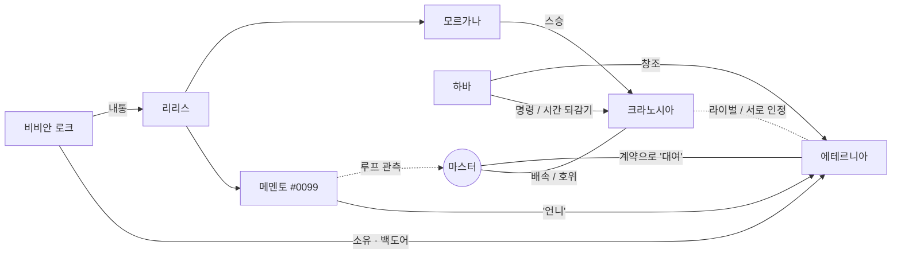

# 캐릭터 바이블

> 원작 설정의 뼈대(소속, 코드, 무장)는 유지하고, **성격의 '이유'와 '모순'**을 새로 부여했다.
> 비주얼 노벨 히로인은 "어떤 사람인가"보다 **"왜 그렇게 행동하는가"를 플레이어가 알아가는 과정**이 곧 루트다.

---

## 주인공 — 마스터 (이름 변경 가능 / 기본값 없음, "마스터"로 불림)

| 항목 | 내용 |
|---|---|
| 신분 | 대공동 저항군 **E등급 마스터**. 원래 보급·병참 담당. 디걸을 지휘해본 적 없음 |
| 성격 | 온화하고 눈치가 빠르다. 결정적인 순간에 **자기 몸을 먼저 던지는 나쁜 버릇**이 있다 |
| 비밀 | 회귀를 '잔향(殘響)'으로 느낀다 — 데자뷔, 이유 없는 두통, 처음 보는 사람의 버릇을 알고 있음 |
| 서술 | 1인칭 독백. 담담하고 약간 자조적. 감정은 과장하지 않는다 |

**테마적 역할** : 1,207번의 회귀 동안 주인공은 늘 **누군가를 지키다 죽었다.** 그래서 크라노시아는 무의식중에 그를 밀어내고, 에테르니아는 그를 '처음 본 것 같지 않다'고 느낀다. 두 루트 모두 결말의 열쇠는 **"혼자 희생하지 않는 것"** 이다.

---

## 크라노시아 (Kranosia)

> **"현재 시각 04:00. 기상하십시오, 지휘관. 인류 멸망까지 29일 남았습니다."**

| 항목 | 내용 |
|---|---|
| 소속 | 지구방위기구 · 차원 전술병기 제어관 |
| 코드명 | 어비스 워든 (Abyss Warden) |
| 등급 | SSS급 디걸 |
| 코드 | **차원의 코드** — 공간을 접고 베는 능력. (진실: 하바가 이것을 증폭해 '시간'을 되감고 있다) |
| 무장 | 미래식 카타나 **「제로 아워」** — 스승 모르가나에게 받은 검 |
| 외형 | 긴 은발, 푸른 눈, 검은 전투 슈트 위에 흰 재킷. 표정 변화가 거의 없다 |
| 소지품 | **멈춘 회중시계** — 바늘이 04:44에 멈춰 있다. 원래 모르가나의 것 |

### 표면 — 얼음 같은 전술가
- 모든 것을 **시간과 숫자로 말한다.** "작전 효율 23% 미달", "대화 소요 시간 4분 12초".
- 판단이 빠르고 냉혹하다. 필요하면 자기 자신도 '소모 가능한 전력'으로 계산한다.
- 주인공을 처음엔 **"지휘관"** 이라고만 부른다. 인정하기 전까지 '마스터'라 부르지 않는다.

### 이면 — 이미 1,207번 당신을 잃은 여자
- 기억은 없지만 **몸이 기억한다.** 주인공이 위험한 곳에 서면 이유 없이 손이 떨린다. 악몽 속에서 누군가가 계속 죽는다.
- 그래서 차갑다. **"정들면 안 된다"는 걸 본능이 알고 있기 때문**이다. 그녀의 냉정함은 성격이 아니라 방어기제다.
- 아군이라면 무조건 지킨다 — 이건 스승 모르가나에게 배운 단 하나의 신념. "진정한 힘은 지키고자 하는 의지에서 나온다."

### 말투 규칙
| 단계 | 호칭 | 어미 | 트리거 |
|---|---|---|---|
| 초기 | 지휘관 | 다나까체 "~입니다 / ~습니까" | — |
| 신뢰 | 마스터 | 다나까체 유지, 가끔 말끝이 흐려짐 | K-01 이후 |
| 붕괴 | 당신 | **처음으로 "~요"가 섞임** | K-08 고백 |

- **말버릇 「…정정합니다.」** : 감정이 새어나온 말을 한 직후, 무표정하게 이 말을 붙인다. 플레이어가 이 말이 나올 때마다 그녀의 진심이 들킨 순간임을 알게 되는 장치.
  - 예) "무사하셔서 다행입니다. …정정합니다. 전력 손실이 없어 다행입니다."
- 웃지 않는다. 대신 **아주 가끔 한쪽 입꼬리만 올라간다** (지문으로만 묘사, CG 포인트).
- 욕설·감탄사 금지. 극한 상황에서만 "…아." 한 음절.

### 갭(Gap) 포인트 — 일상 파트용
- **극심한 길치.** 전장에선 좌표로 움직이니 완벽하지만, 시장·상가처럼 '좌표 없는 공간'에선 같은 곳을 뱅뱅 돈다. 본인은 "적의 공간 교란"이라고 주장.
- **요리는 레시피를 문자 그대로 해석한다.** "소금 약간" → "약간의 정의를 요청합니다."
- 길고양이에게만 목소리가 반 톤 올라간다. 들키면 "…정찰 중이었습니다."
- 알람 없이 매일 04:00 기상. 이유는 본인도 모름. (진실: 루프 리셋 시각이 04:44)

### 크라노시아 루트의 성장 아크
**"혼자 짊어지는 검" → "함께 내일로 가는 사람"**
처음엔 주인공을 지키기 위해 주인공을 밀어낸다. 루트 후반, 자신이 회귀의 '열쇠'라는 걸 알게 되고, 주인공을 살리기 위해 **시간 자체를 멈출 수 있는 힘**을 손에 쥔다. 해피엔딩은 그 힘을 **쓰지 않는** 선택 — 주인공이 죽을지도 모르는 '내일'을 받아들이는 것이다.

### 금지사항 (캐릭터 붕괴 방지)
- 먼저 "사랑해요"라고 말하지 않는다. 고백은 행동 또는 우회적 표현으로.
- 울면서 매달리지 않는다. 울 때는 **표정 변화 없이 눈물만** 흐른다.
- 애교 금지. 코스튬 이벤트(메이드, 바니 등)는 DLC/외전 용으로 분리 — 본편 톤을 해치지 않게.

---

## 에테르니아 (Eternia)

> **"오늘도 여러분의 곁에, 아르카나의 성녀가 함께합니다♪" … "— 아, 진짜. 이 대사 누가 쓴 거야."**

| 항목 | 내용 |
|---|---|
| 소속 | 아르카나 연합 (기업 연합체) 소유 디걸 |
| 코드명 | 파괴의 성녀 |
| 코드 | **신성의 코드** — 광범위 치유 |
| 무장 | 메카 윙 **「세라핌」** — 발칸 포대, 호밍 미사일, 심판의 레이저 「저지먼트」 |
| 외형 | 긴 분홍 머리, 붉은 눈, 흰 전투 슈트와 거대한 기계 날개 |
| 거처 | 대공동 고지대 **희망의 정원** (아르카나 연합이 기부한 시민 공원, 겸 그녀의 홍보 무대) |

### 표면 — 완벽한 성녀
- 아르카나 연합의 **걸어다니는 광고판.** 아이들을 치료하고, 카메라 앞에서 미소 짓고, 연합이 써준 대사를 말한다.
- 말투는 우아한 공주체. "~랍니다", "~하시겠어요?", 문장 끝에 음표가 붙는 느낌.
- 누구에게나 친절하지만 **누구에게도 진짜 얼굴을 보여주지 않는다.**

### 이면 — 새장 속에서 총을 쏘는 새
- 성녀 모드가 꺼지면 **반말, 건조하고 빠른 말투, 날카로운 독설.** 사실 굉장히 머리가 좋고 냉소적이다.
- 가장 싫어하는 것 : **"사용되는 것."** 연합에게 그녀는 치유 서비스이자 병기이자 홍보 모델이다. 계약서상 그녀의 소유주는 그녀 자신이 아니다.
- **기도하는 포화** : 적을 파괴할 때마다 그 숫자를 센다. "…삼만 칠천 이백 열넷. 다음엔 꽃으로 태어나." 파괴한 메탈리온 전부를 기억한다. 치유의 코드를 가진 자가 누구보다 많이 죽인다는 모순을 혼자 견디는 방식.
- 꿈 : **진짜 하늘.** 대공동의 인공 하늘은 아무리 높이 날아도 천장에 닿는다.

### 말투 규칙
| 모드 | 호칭 | 어미 | 예시 |
|---|---|---|---|
| 성녀 모드 (공적) | 마스터님 | 존댓말, 공주체 | "어머, 다치셨나요? 제가 치료해드릴게요♪" |
| 진짜 모드 (사적) | 너 / 마스터 | **반말** | "다쳤으면 다쳤다고 말해. 멍청하게 참지 말고." |

- 공통 루트에선 성녀 모드만 나온다. **E-03에서 처음 진짜 모드를 목격**하는 것이 에테르니아 루트의 첫 번째 전환점. 이후 둘만 있을 때만 반말.
- 진짜 모드에서도 아이들 앞에선 절대 성녀 모드를 깨지 않는다 — "애들한텐 거짓말도 진심이어야 돼."
- 질투는 성녀 모드로 한다. 웃으면서 무섭게. "어머, 크라노시아 씨랑 즐거우셨나 봐요? 다행이네요♪ (발칸 포대 회전음)"

### 갭 포인트
- 수영 못함. 날개가 물을 먹으면 가라앉는다. "물리적으로 불가능한 걸 노력으로 해결하라는 건 연합 마케팅팀 같은 소리야."
- 정원의 허브는 진짜로 직접 키운다. 이것만은 홍보용이 아니다.
- 인간의 연애 드라마를 몰래 본다. 비평이 신랄하다.

### 에테르니아 루트의 성장 아크
**"누군가의 소유물" → "스스로의 이름"**
마스터는 그녀를 '빌리기' 위해 연합과 계약한다. 즉 처음 관계부터 '소유'의 구조 안에 있다. 루트는 그 구조를 부수는 이야기다. 그리고 그녀를 소유하려는 자 중 하나가 **리리스의 내통자**다.

### 금지사항
- 성녀 모드에서 진심을 말하지 않는다. 진심은 반드시 반말로.
- 자기 연민으로 울지 않는다. 운다면 **남을 위해서** 운다.

---

## 조연

### 하바 (HAVA / 하바) — 대공동의 지도자, 슈퍼컴퓨터
- 여성형 음성. 부드럽고 모성적. 디걸들을 **"나의 아이들"** 이라 부른다.
- 절대 언성을 높이지 않는다. 질문에 질문으로 답한다. **거짓말은 하지 않는다 — 다만 말하지 않을 뿐.**
- 연출 : 등장 시 배경음이 한 박자 늦게 끊기는 등 미세한 위화감.
- 1차 출시 범위에서의 진실 : 크라노시아의 코드로 시간을 되감고 있다. (왜 그러는지, 뇌 데이터 도둑질은 진실 루트에서)

### 메멘토 — 네피림 「기록하는 자」
- 리리스 휘하 네피림. 예의 바르고 연극적. 모든 걸 기록한다.
- **루프를 인지하는 또 다른 존재.** 매 회차 "오차율"을 측정한다. 주인공에게 흥미를 가진다.
- 정체 (에테르니아 루트) : 하바의 디걸 프로토타입 **#0099**. 폐기 직전 리리스가 주워갔다. 에테르니아(#0100)는 그녀의 '다음 번호'.
- 힌트 코너 「메멘토의 오차 보정실」 진행자 (데드엔드 후, 제4의 벽을 넘는 개그 파트).

### 모르가나 — 네피림 「황혼의 기사」
- 과거 아담 휘하 **태양의 기사단장.** 크라노시아의 스승. 하바에 의해 '데이터 오염'으로 기록 말소.
- 지금은 리리스 측 네피림. 침식된 붉은 눈. 고풍스러운 기사 말투 "~하라, ~이로다".
- 크라노시아에게 "지키고자 하는 의지"를 가르친 사람이 **이제 그녀가 지키는 것을 베러 온다.**

### 비비안 로크 — 아르카나 연합 대공동 지부 관리관
- 에테르니아의 '관리 책임자'. 늘 웃는 얼굴, 업무용 존댓말, 계약서 조항을 외우고 다닌다.
- **리리스의 내통자.** 에테르니아의 날개 펌웨어에 침식 코드 백도어 「성녀 프로토콜 S-9」를 심어두었다.
- 동기 : 대공동은 어차피 망한다. 리리스 쪽에 붙으면 '데이터로라도' 살아남는다.

### 커뮤니 — 대공동 오퍼레이터 AI
- 밝고 수다스러운 통신 담당. 긴장 완화 역할. 루프를 전혀 모른다.

### 카메오 (1차 출시 범위)
- **인페르니아** : 프롤로그 메멘토 습격 때 가장 먼저 덤벼드는 디걸. 공통 루트에서 짧게 등장.
- **글레이시아** : 에테르니아 루트 E-06에서 펌웨어 해킹 담당으로 조력.

---

## 관계도

- 크라노시아 ↔ 에테르니아 : 소속이 달라 공개석상에선 날이 서 있다. 크라노시아는 에테르니아를 "아르카나의 광고판", 에테르니아는 크라노시아를 "하바님의 시곗바늘"이라 부른다. 하지만 **전장에서 서로의 등을 맡길 수 있는 유일한 상대.** 각자의 루트에서 상대 히로인은 결정적인 순간에 조력자로 등장한다.
