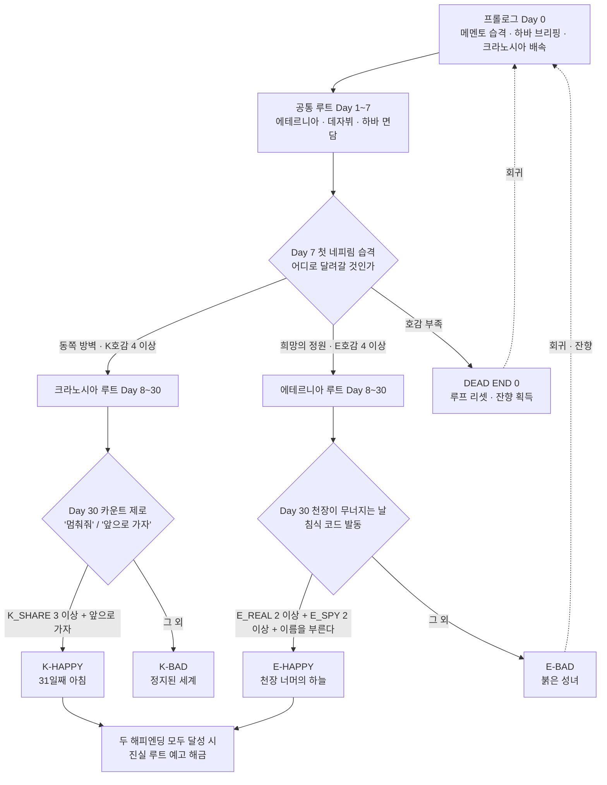

# 디스토피아 걸즈 : 카운트다운 — 비주얼 노벨 기획서 (v0.1)

> 원작 「디스토피아 걸즈 카운트다운」(Steam) 대화 데이터는 **참고만** 하고, 대사·캐릭터성·분기는 전부 새로 짰다.
> 목표 : 월희(月姫)처럼 **공통 루트 → 히로인 루트 분기 → 루트별 해피/배드** 구조. 1차 출시는 **크라노시아 / 에테르니아 2루트, 엔딩 4개**.

---

## 문서 구성

| 파일 | 내용 |
|---|---|
| `README.md` | 이 문서. 컨셉, 전체 구조, 엔진 제안 |
| `01_캐릭터바이블.md` | 등장인물 설정, 말투 규칙, 금지사항, 관계도 |
| `02_분기_플래그설계.md` | 변수·플래그, 선택지별 수치표, 엔딩 조건, 잔향(회귀) 시스템 |
| `scenario/00_프롤로그.md` | Day 0 — 메멘토 습격, 하바 브리핑, 크라노시아와의 첫 만남 |
| `scenario/01_공통루트.md` | Day 1~7 — 에테르니아와의 만남, 데자뷔, 루트 분기 |
| `scenario/K_크라노시아루트.md` | Day 8~30 + 엔딩 2종 |
| `scenario/E_에테르니아루트.md` | Day 8~30 + 엔딩 2종 |

---

## 1. 한 줄 컨셉

**"30일 후 인류는 멸망한다. 그리고 나는, 그 30일을 몇 번째 살고 있는지 모른다."**

슈퍼컴퓨터 하바는 크라노시아의 **차원의 코드**를 증폭시켜, 인류가 멸망할 때마다 시간을 Day 0으로 되감고 있다.
모든 존재는 되감기를 기억하지 못한다. 단, 평범한 E등급 마스터인 **주인공만이 '잔향(殘響)'이라는 형태로 어렴풋이 그것을 느낀다.**

## 2. 톤 & 레퍼런스

- **월희** : 1인칭 독백 중심의 서술, 일상 속에 스며드는 이질감, 히로인마다 전혀 다른 진실이 보이는 구조, 배드엔딩의 무게감, 데드엔드 후 힌트 코너.
- **슈타인즈 게이트 / Ever17** : 회귀를 '게임 시스템'과 연결. 배드엔딩을 본 기억이 다음 회차의 선택지를 바꾼다.
- 톤 : 평소엔 담백하고 가끔 웃기다가, 진실에 다가갈수록 차갑고 조용해진다. 연애 감정은 **대사보다 행동과 침묵**으로 보여준다.

## 3. 전체 구조



### 30일 타임라인

| 구간 | Day | 내용 |
|---|---|---|
| 프롤로그 | 0 | 메멘토 습격 → 하바 브리핑 → 크라노시아 배속, 첫 시험 |
| 공통 루트 | 1~7 | 에테르니아와의 만남, 데자뷔, 하바 면담, 자유행동 선택, 첫 네피림 습격에서 분기 |
| 개별 루트 | 8~29 | 히로인별 8~9개 핵심 씬 (일상 → 균열 → 진실) |
| 클라이맥스 | 30 | 리리스 대침공. 루트별 최종 선택 → 엔딩 |

### 루트별로 밝혀지는 진실 (월희식 '진실의 분할')

한 루트에서 모든 걸 밝히지 않는다. 두 루트를 다 봐야 전체 윤곽이 보이고, **최종 진실(하바가 리리스의 뇌 데이터를 훔쳤다)은 3번째 '진실 루트'로 아껴둔다.**

| | 크라노시아 루트 | 에테르니아 루트 |
|---|---|---|
| 핵심 질문 | "왜 시간은 되돌아오는가" | "디걸은 누구의 소유인가" |
| 밝혀지는 것 | 하바가 크라노시아의 코드로 시간을 되감고 있다. 크라노시아는 아담이 만든 기체라 회귀의 잔재가 남는다. 이번이 **1,208번째** 30일이다. | 디걸 프로토타입 #0001~#0099는 폐기됐다. **메멘토는 #0099** 였다. 아르카나 연합 간부 중 리리스의 내통자가 있다. |
| 적 네피림 | 황혼의 기사 모르가나 (크라노시아의 스승) | 기록하는 자 메멘토 (에테르니아의 '언니') |
| 떡밥만 남기는 것 | '유리'라는 이름, 분홍 토끼 인형 | 하바가 버린 것 중 '데이터'가 있었다 |

## 4. 엔딩 목록

| 코드 | 제목 | 한 줄 |
|---|---|---|
| K-HAPPY | **31일째 아침** | 처음으로 카운트다운이 0을 지나간다. 크라노시아가 처음으로 '내일'을 본다. |
| K-BAD | **정지된 세계** | 그녀는 나를 잃지 않기 위해 시간을 멈췄다. 회귀조차 일어나지 않는 유일한 결말. |
| E-HAPPY | **천장 너머의 하늘** | 성녀도 병기도 아닌 에테르니아로서, 진짜 하늘을 난다. |
| E-BAD | **붉은 성녀** | 침식된 그녀는 정원을 불태운다. 마지막 순간 기도의 숫자가 나의 이름이 된다. |
| (비공식) DEAD END ×4 | 루프 리셋 | 엔딩으로 치지 않음. 잔향을 얻고 Day 0으로. 힌트 코너 「메멘토의 오차 보정실」 |

---

## 5. 엔진 제안 : Unity + Ink 추천

결론부터 말하면 **Unity가 맞다.** 이유는 "루트를 넘나드는 게 렌파이로 안 돼서"가 아니라(렌파이도 `persistent` 변수로 회차 간 데이터 공유는 된다), 아래 이유 때문이다.

1. **기존 게임이 이미 Unity다.** 원작 데이터가 `.asset`(ScriptableObject) 형태 — 캐릭터 이미지, 카드/전투, 아이템 에셋을 재활용할 수 있다.
2. **전투·연출 확장성.** 나중에 원작의 카드 전투를 루트 중간 이벤트로 넣거나, 루프 리셋 시 화면이 되감기는 셰이더 연출 같은 걸 하기엔 Unity가 압도적으로 편하다.
3. **회귀(잔향) 시스템.** 회차 간 영구 데이터, 이미 본 문장 표시, "다른 루트에서 본 것 때문에 이번 루트에 선택지가 생기는" 구조를 직접 설계할 수 있다.

**스크립트 도구는 Ink(inkle) 추천.** 텍스트 파일로 작가가 직접 쓰고, 변수/조건 분기가 강력하며 Unity 공식 플러그인이 있다. (대안: Yarn Spinner — 더 '대본' 느낌이지만 복잡한 상태 관리는 Ink가 낫다.)

> 지금 작성한 `scenario/*.md`는 엔진 독립적인 대본 포맷이다. 규칙이 일정해서 나중에 **Ink / Yarn / ScriptableObject로 자동 변환하는 스크립트**를 바로 만들 수 있다.

### 대본 표기 규칙

```
@scene K-03 대공동 하층 시장 / 오후      ← 씬 ID, 장소 / 시간
@bg 시장_오후  @bgm 일상_02  @se 군중소음  ← 연출 태그
@show 크라노시아 [무표정] center          ← 스탠딩 CG, [표정], 위치
@cg K_03_길치                            ← 이벤트 CG

지문(태그 없는 문장) = 주인공 '나'의 1인칭 독백/서술
마스터: 주인공이 소리 내어 하는 대사
캐릭터[진짜]: 에테르니아처럼 모드가 있는 캐릭터는 [ ]로 모드/표정 표시
크라노시아: 대사
크라노시아[당황]: 표정이 바뀌는 대사

? 선택지 제목                             ← 선택지 블록 시작
  > 선택지 A  {K_AFF+1, K_SHARE+1}        ← {} 안은 변수 변화
    (A를 골랐을 때의 반응)
  > 선택지 B  {E_AFF+1}
  > ◆ 잔향 선택지  [if ECHO>=1]           ← ◆ = 회귀 경험이 있어야 보이는 선택지
@if K_SHARE >= 3 ... @elif ... @else ... @endif   ← 조건 분기
@jump K-04                               ← 다음 씬
@flag K_WATCH_SEEN                       ← 플래그 세우기
@persistent ECHO+1, SEEN_K_BAD            ← 회차를 넘어 유지되는 영구 변수
@title / @text                           ← 챕터·엔딩 타이틀 카드
```
